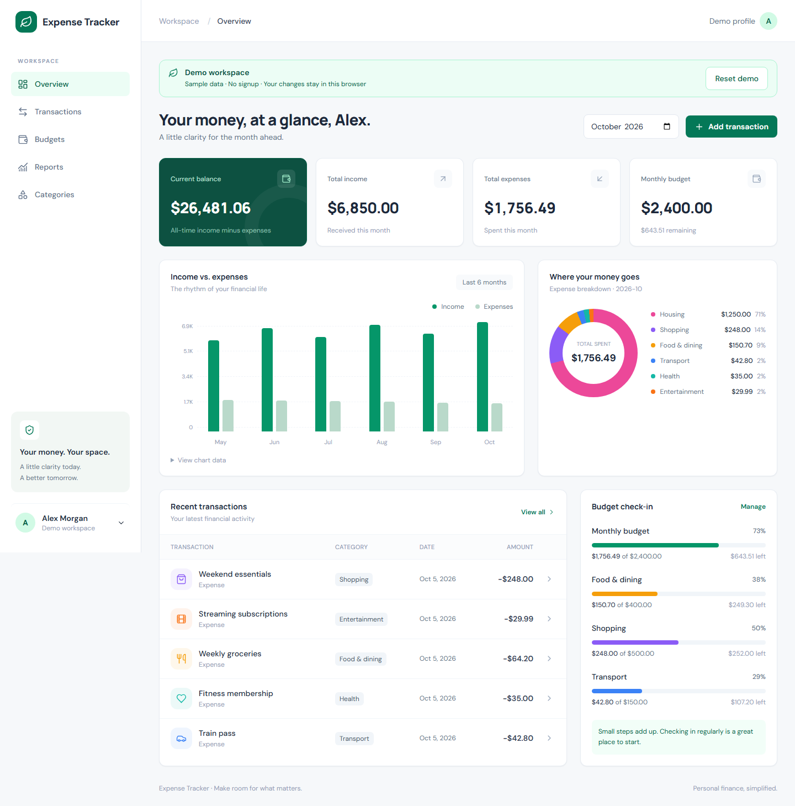

# Expense Tracker

[**Live app**](https://expense-tracker-bryanlollers.vercel.app)

A responsive personal finance portfolio project built with Nuxt 3, Vue 3, TypeScript, Tailwind CSS, Pinia, and Supabase.

## About

- This app is a portfolio project for demonstration and educational purposes only.
- The brand name is a fictional placeholder, not an actual business or a claim to a registered trademark. Any resemblance to existing brands is coincidental; no affiliation or endorsement is implied.
- This app is not monetized.
- Stored data, including accounts, transactions, and receipts, may be deleted at any time without notice. Availability and data retention are not guaranteed.
- Use sample data only. Do not upload sensitive personal, financial, or payment information, and do not rely on this app as your only financial record.
- The app does not provide financial, investment, tax, or accounting advice.

## Getting started

Create an account or sign in to manage your transactions, budgets, categories, and profile. Account data is stored in Supabase, with receipts kept in private Storage.

## Features

- Income and expense tracking with search, filters, sorting, and pagination.
- Dashboard charts, monthly and category budgets, and CSV reports.
- Custom categories, 42 display currencies, and receipts up to 5 MB.
- Responsive desktop and mobile layouts with accessible forms and feedback.

## Screenshots

[Mobile screenshot](docs/screenshots/demo-mobile.png)

## Engineering highlights

Vue Composition API, reusable components, focused Pinia stores, typed composables, and shared validation keep the application organized.

The application uses Supabase authentication, PostgreSQL migrations, and private Storage. Row Level Security enforces ownership on profiles, categories, transactions, and budgets. Composite foreign keys prevent cross-account category references.

Automated tests cover authentication, financial calculations, validation, receipts, and database security. See the [verification record](docs/verification.md).

Display currencies relabel amounts without conversion.

## Future improvements

Recurring transactions, CSV import, password recovery, and receipt OCR.
